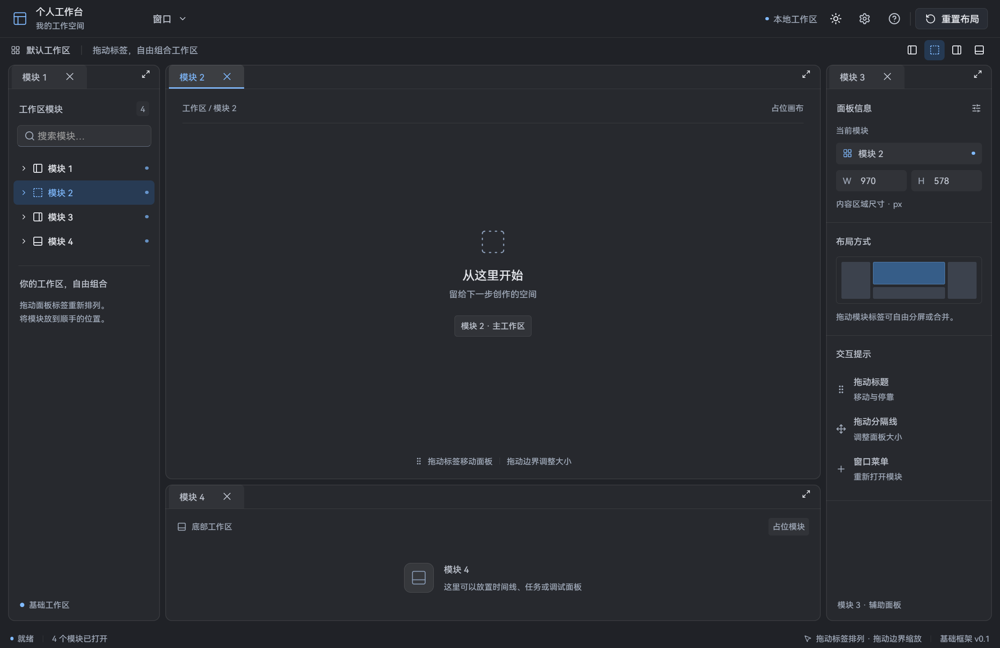

# 个人工作台

以网页界面为基础的个人工作台开发项目，计划通过可扩展模块整合创作工具、资产与 AI 节点工作流。

## 当前状态

- 已明确总体方向：音乐、3D 建模、平面设计、视频制作等模块，以及优先级最高的 AI 节点图模块。
- 技术栈已确定为 Electron + React + TypeScript + Vite；布局采用 Dockview，UI 采用微软 Fluent 黑白双主题磨砂玻璃风格（默认深色）。
- 已完成模块 1—4 的基础框架，支持拖拽分屏、标签分组、尺寸调整、关闭重开和最大化；暂不接入真实插件或 AI 服务。
- 本地 Git 默认分支：`main`。

## 项目导航

| 文件                 | 用途                               |
| -------------------- | ---------------------------------- |
| `AGENTS.md`          | AI 开发协作约定与项目约束          |
| `docs/需求与规划.md` | 产品设想、需求边界和阶段规划       |
| `docs/技术决策.md`   | 已确认的重要技术选择及其理由       |
| `.gitignore`         | 排除凭据、私人数据、缓存和生成文件 |
| `.editorconfig`      | 统一基础文本格式                   |

## 本地运行

已验证 Node.js **24.19.0**、npm **11.17.0**。首次安装执行 `npm ci`，然后 `npm run doctor`。详见 [开发流程](docs/开发流程.md)。

| 命令                | 用途                                                         |
| ------------------- | ------------------------------------------------------------ |
| `npm run dev`       | 启动 Electron 桌面开发窗口                                   |
| `npm run dev:web`   | 在浏览器预览界面，地址为 http://127.0.0.1:5173               |
| `npm run typecheck` | TypeScript 类型检查                                          |
| `npm run build`     | 类型检查并构建桌面程序代码                                   |
| `npm start`         | 构建后打开桌面程序（尚非安装包）                             |
| `npm test`          | 构建并分别在发布代码、开发模式下运行 Electron 端到端交互测试 |

构建输出位于 `out/`，当前尚未制作可分发安装包。

## 基础工作区

- 拖动模块标签到另一个面板的边缘可分屏，拖到标签栏可合并。
- 拖动面板间的分隔线可调整宽高。
- 标签上的关闭按钮可关闭模块；顶部「窗口」菜单或四个模块图标可重新打开。
- 面板右上角可最大化或还原；全局「重置布局」恢复四面板排列。
- 当前仅保存本次运行中的布局，重启恢复默认布局；跨次运行的布局保存后续再做。
- 当前采用微软 Fluent 黑白双主题磨砂玻璃风格（默认深色）；Windows 11 22H2+ 启用原生 Acrylic，其他环境使用对应主题的实色背景回退。系统关闭透明效果时原生材质可能变为实色。布局来自 Dockview 开源包，图标来自 Lucide。中文优先使用本机 HarmonyOS Sans SC，回退微软雅黑 UI，不分发字体文件。

已验证：Electron 真实窗口的四面板显示、960×720 窗口适配、鼠标拖拽合并与分屏、横纵分隔线缩放、关闭重开、最大化还原及空工作区恢复。测试使用独立 profile，不修改日常工作区。

## 本地数据约定

真实凭据使用 `.env` 等本地配置文件；如后续需要配置模板，提交仅含占位值的 `.env.example`。
私人资料、运行数据和备份可放在 `data/`、`local/`、`backups/` 中，这些目录不会纳入版本控制。
忽略规则不能保护已经被 Git 跟踪的文件，提交前仍需检查变更。

右上角太阳／月亮按钮切换深浅主题，首次启动默认深色，之后记住本机选择；窗口原生材质同步切换。
