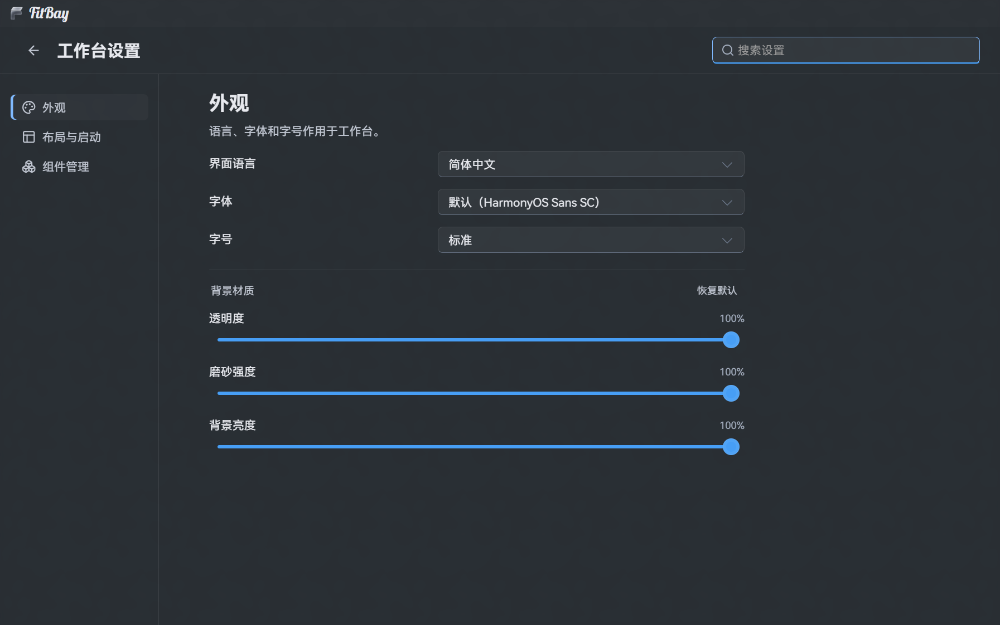

# 设计规范

## 当前确认方案

微软 Fluent 磨砂玻璃，固定深色玻璃、舒适密度、经典蓝强调色与柔和圆角；Penpot 仅为历史参考。设计参数唯一入口为 `src/renderer/src/styles/tokens.css`，`global.css` 与 `appearance.css` 使用这些变量，模块不自行另建配色。

| 参数               | 现有约定                                                                                      |
| ------------------ | --------------------------------------------------------------------------------------------- |
| 背景 / 正文 / 强调 | 深色 #202227 / #e7e9ee / #80baff                                                              |
| 表面与边界         | --glass、--control、--stroke、--edge-highlight；工作台底色透明度可调                          |
| 中文字体           | HarmonyOS Sans SC → Microsoft YaHei UI → Microsoft YaHei → Segoe UI Variable → sans-serif     |
| 字号               | caption 12、control 13、body 14、heading 16、empty 18、title 24px                             |
| 字重 / 行高        | 400、500；常规 1.5，提示 1.7，说明 1.9                                                        |
| 间距               | --space-* 保存当前实际 px 数值，含历史紧凑微调值，不强行改为新网格；Dockview 间隙取 --space-8 |
| 圆角               | --radius-* 保留当前值；控件 6、面板 10、弹窗 12、画布 18px；圆点/头像为 50%                   |
| 阴影               | --shadow-panel / menu / canvas / dialog；使用深色阴影                                         |
| 材质               | 透明外壳与轻量半透明面板，菜单/弹窗默认 blur(28px)，背景透明着色；无持续动画                  |

尺寸（窗口宽高、面板最小尺寸、图标大小）是组件几何，不混作主题变量。原生窗口实色回退在主进程对应 #202227；修改背景时需同步该回退。

工作区内容延伸至窗口底部，仅播放栏模式在底部预留 40 像素。封面、可拖播放进度、播放模式、桌面歌词、队列、传输按钮、音量和展开同排。音量在原行展开，打开队列时恢复完整窗口。停靠组中只有 Music 标签时，标签条高度为 38px；Music 与其他标签同组时沿用 32px。

## 工作台设置

工作台将品牌、组件、布局与设置整合在同一条 40px 标题栏中。26px 标志与 20px Lobster 字标垂直居中，两个菜单相距 2px。仅在有命名布局时显示其名称。右侧齿轮为系统窗口按钮留出空间，空白区域可拖动窗口。窄窗口收起布局名。标题栏仅 FitBay 字标使用 Lobster。齿轮在同一窗口打开完整设置页，宽窗使用分类侧栏，窄窗展开分类导航。关闭后恢复原工作区。空工作区的「快速开始」按实际安装情况显示组件图标与名称。界面语言支持简体中文和 English。字体可选默认字体栈、微软雅黑 UI 和 Segoe UI Variable。字号在现有层级上统一调整，小号减 1px，标准沿用原值，大号加 2px。语言、字体和字号作用于工作台。设置中的选择器与停靠 Music 的下拉菜单共享灰蓝玻璃材质。

材质滑杆支持拖动和方向键。透明度控制底色遮盖，磨砂强度调节表面颗粒和弹层背后的模糊，背景亮度调节底色明暗。首次使用时三项均为 100%，已有 profile 保留各项保存值。「恢复默认」只重置这三项。透明度全程保留深色底层，Windows 标题栏与工作台栏共用同一材质，系统按钮使用 Electron 原生窗口控件。减少透明度与强制颜色模式沿用系统回退。六项偏好写入同一 profile 的 `workbench.preferences.v1`，与布局独立。

Windows 提供窗口背后的 Acrylic，Electron 公开接口只选择系统材质；应用内滑杆调节渲染层。参见 [Acrylic 材质](https://learn.microsoft.com/en-us/windows/apps/design/style/acrylic)、[系统背景](https://learn.microsoft.com/en-us/windows/apps/develop/ui/system-backdrops)和 [WinUI Gallery 示例](https://github.com/microsoft/WinUI-Gallery/blob/main/WinUIGallery/Samples/Acrylic/AcrylicPage.xaml)。

顶栏原生截图：[1400px 宽窗](images/workbench-header-wide.png)和[920px 窄窗](images/workbench-header-narrow.png)。两种宽度均核对菜单与系统按钮命中区域。

设置页占用工作区，打开期间保留 Dockview、播放实例和组件状态，返回时恢复原页面。Music 的「未收听时间」同步采用工作台材质，见[三项均为 100%](images/music-days-glass.png)和[三项均为 0%](images/music-days-glass-adjusted.png)。

工作台设置的「组件管理」为支持后台运行的组件分别提供「关闭后继续在后台运行」。默认关闭开关。Windows 通知区域共用一个 FitBay 图标，单击恢复工作台，右键显示后台组件或退出 FitBay。

## 状态

- 普通：文字 --text/--text-secondary，控件 --control。
- 悬停：--hover；主按钮 --accent-hover；已选模块保留 --accent-soft。
- 选中：--accent-soft 背景与 --accent 文字，Dockview 当前标签使用 --tab-active。
- 禁用：原生 disabled 属性阻止激活，--opacity-disabled=0.45、not-allowed 光标；不只靠颜色模拟禁用。当前没有业务禁用按钮，不添加虚假控件。
- 键盘焦点：按钮/输入框 focus-visible 使用 2px --accent 轮廓；保留 Dockview 原生标签导航，不移除轮廓。帮助框支持 Escape 与关闭按钮。

## 字体、透明与截图验收

验收时从实际入口首次打开改动的界面，对照工作台普通面板检查背景、文字和控件。涉及菜单、下拉或对话框时，展开后截图，确认弹层和输入框也继承深色主题；组件支持独立与停靠时，两种形态均须检查改动处。普通显示模式下出现浏览器或控件库默认白底，视为主题接入未完成。系统强制颜色模式按下述无障碍回退验收。

字体仅引用本机安装，不拷贝、不打包；缺失鸿蒙字体时自动回退，CI 字体不保证与个人电脑一致。字体分发需另行核查许可。

Windows 11 build 22621+ 使用原生 Acrylic；旧系统和浏览器背景使用主题实色。系统关闭透明效果时原生材质由系统回退；CSS prefers-reduced-transparency 和不支持 backdrop-filter 时面板改实色。forced-colors 使用 Canvas/CanvasText，减少动态效果时关闭动画与过渡。

视觉修改必须检查真实 Electron 渲染的深色截图，以及文字、面板边界、焦点和必要回退状态。后台测试输出 tmp/workbench-verified.png；它们是实际渲染截图，但屏幕外测试不能完整代表桌面壁纸透过原生 Acrylic 的效果，该材质最终仍需用户在桌面观察。文档仅收录选定截图，不能以构建成功代替视觉验收。

## 官方控件样板（等待视觉验收）

现有重置/帮助按钮、窗口菜单、模块搜索、帮助对话框使用 Fluent UI React v9；不增加展示页面，不更改 Dockview。菜单方向键/Home/End、Escape、弹窗焦点约束与关闭后焦点恢复交由官方实现；现有测试覆盖搜索结果、键盘导航与焦点恢复。其他按钮保持原状，用户验收后才讨论扩大替换。

`app/ComponentTheme.tsx` 是工作台与组件的公共主题入口，统一引入 tokens 和 componentTheme.css。面板材质由当前承载面绘制一次。独立和停靠时均以普通面板为视觉参照。

`app/fluentTheme.ts` 将官方主题中的配色、字体、字重、圆角与阴影映射到 tokens.css；官方基础主题只提供控件结构所需默认值，不维护第二份品牌配色。官方控件的焦点由组件绘制，使用现有 accent；全局自定义按钮规则不覆盖 fui-Button。弹出层通过 Portal 避免 Dockview overflow 裁切，仍使用同一组主题变量。控件并不提供 Windows 原生 Acrylic，CSS blur 和主进程背景材质需要分别验收。

实际依赖 9.75.1 的 React peer 范围为 >=16.14.0 <20.0.0，本项目 React 19.3.1 在范围内；Electron Chromium 运行网页控件，Dockview 管理布局，两者没有替换关系。安装后类型、构建与交互验证通过。代价：当前未压缩 renderer JS 从约 1.46 MB 增至 2.06 MB；此数值不是安装包体积或启动耗时，不据此宣称性能优化。

## 首次空工作区

首次进入时只提供一个主操作。已安装 Music 时显示[打开 Music](images/workspace-installed-first.png)，未安装时显示[添加组件](images/workspace-missing-first.png)。使用过组件后清空布局，回到[普通空工作区](images/workspace-installed-cleared.png)，再次启动仍保持为空。
